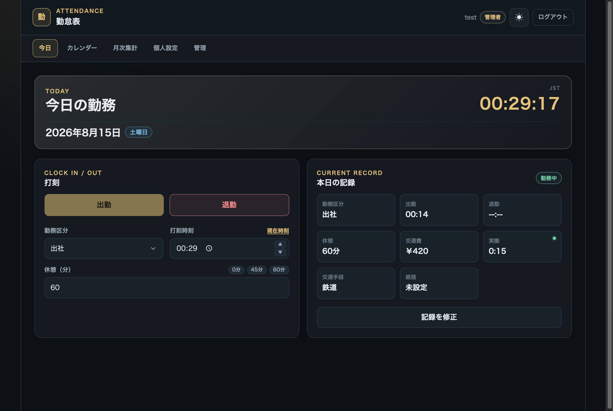
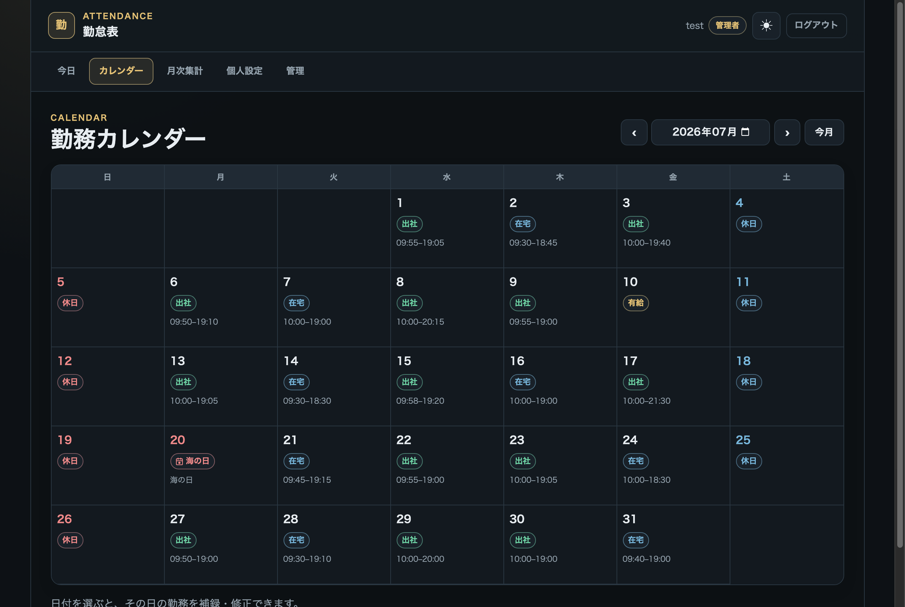
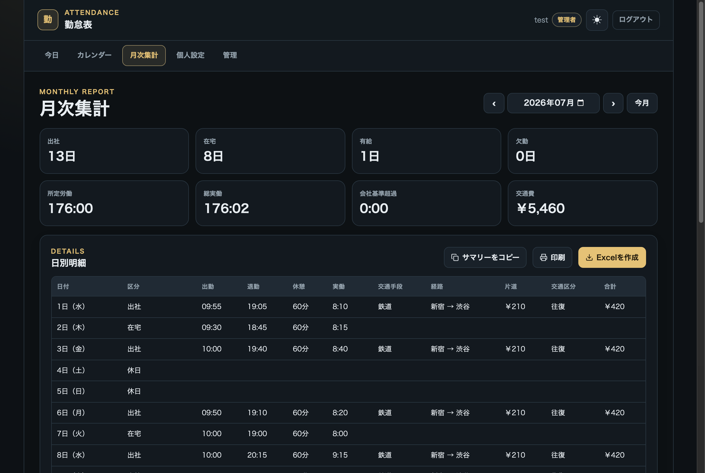
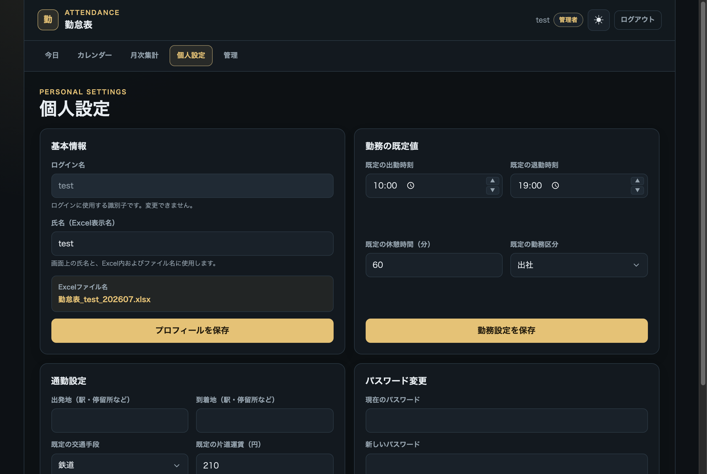
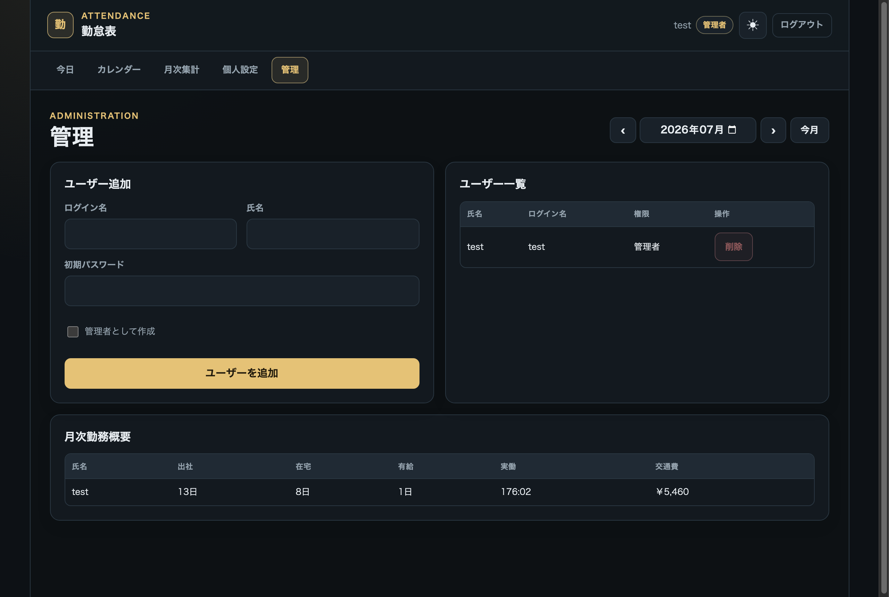

# EdgeKintai

Cloudflare Workers + D1 で動作する、多ユーザー対応の勤怠管理システム。Workers Free プランで利用でき、R2 や外部データベースは不要です。

[](https://deploy.workers.cloudflare.com/?url=https://github.com/workHMZ/EdgeKintai)

## 主な機能

- 出社・在宅・有給休暇・休日・欠勤の記録、出退勤の打刻
- 祝日カレンダー、未打刻・未退勤の確認、月次集計
- 通勤経路・交通費の記録、ユーザーごとの勤務設定
- 出勤簿・集計・交通費明細の Excel 出力、A4 印刷、集計のコピー
- 管理者によるユーザー管理・月次勤務概要の確認
- スマートフォン・Safari 対応、ホーム画面への追加、ダーク／ライトテーマ

## スクリーンショット

| ログイン | 今日の打刻 |
|:---:|:---:|
|  |  |
| **勤務カレンダー** | **月次集計・日別明細** |
|  |  |
| **個人設定・通勤設定** | **管理画面・月次概要** |
|  |  |

## デプロイ

Node.js 24.11 以降の 24.x と npm を使用します。

```bash
npm ci
npm run deploy:cf
```

検証、Cloudflare ログイン確認、D1 作成・設定、スキーマ適用、`SETUP_TOKEN` 設定、デプロイを順に実行します。公開 URL を開き、Setup Token で初期管理者を作成してください。

上部の Deploy to Cloudflare ボタンからも導入できます。求められた `SETUP_TOKEN` は `openssl rand -hex 32` で生成し、Cloudflare の Secret に保存します。

Workers Builds を設定する場合は、既存の D1 バインディングと `SETUP_TOKEN` を確認し、次の値を指定してください。

| 設定 | 値 |
|---|---|
| Production branch | `main` |
| Build command | `npm run verify` |
| Deploy command | `npm run deploy` |
| Build variable | `NODE_VERSION=24.22.1` |

**既存環境の更新:** DB の準備・更新には `npm run db:migrate:local` / `npm run db:migrate:remote` または `npm run deploy` を使用してください。旧版の更新が完了した DB は構造を検証し、データと既存の移行履歴を保持して引き継ぎます。未完了・未知の構造では停止するため、先に旧版の更新を完了してください。`wrangler d1 migrations apply` の直接実行は避けてください。

## ローカル開発

```bash
npm ci
cp .dev.vars.example .dev.vars
# Set SETUP_TOKEN in .dev.vars to a value generated by openssl rand -hex 32.
npm run db:migrate:local
npm run dev -- --local-protocol https
```

`https://localhost:8787` を開き、Setup Token で初期管理者を作成します。セッション Cookie に `Secure` を使用するため、ローカルでも HTTPS を使います。

| コマンド | 用途 |
|---|---|
| `npm run verify` | 型チェック・テスト・デプロイ設定の検証 |
| `npm run deploy:dry-run` | 公開せずにデプロイ用ビルドを確認 |
| `npm run deploy` | 既存環境の DB 更新と Worker デプロイ |

## 設定

既定値は `wrangler.jsonc` で設定します。勤務時刻・休憩・通勤費はユーザーごとの設定が優先されます。

| 変数 | 既定値 | 用途 |
|---|---|---|
| `DEFAULT_BREAK_MINUTES` | `60` | 休憩時間（分） |
| `DEFAULT_ONE_WAY_FARE` | `210` | 片道交通費（円） |
| `DEFAULT_TRIP_TYPE` | `round_trip` | `one_way` または `round_trip` |
| `DEFAULT_CLOCK_IN` / `DEFAULT_CLOCK_OUT` | `10:00` / `19:00` | 勤務時刻 |
| `OVERTIME_THRESHOLD_HOURS` | `180` | 月次アラートの閾値（時間） |
| `SESSION_TTL_SECONDS` | `604800` | セッション有効期間（秒） |
| `HEALTH_PROBE_ALLOWED_ORIGINS` | 空 | `/health` の読み取りを許可するブラウザ Origin（カンマ区切り） |

`GET /health` は DB にアクセスしない公開の死活確認です。DB を含む確認には、認証が必要な `GET /api/health/ready` を使用します。

## データとセキュリティ

- 勤怠・氏名・通勤経路は D1 に保存します。Excel はブラウザ内で生成し、利用者の端末へ保存します。
- パスワードは PBKDF2-SHA-256、セッションは SHA-256 ダイジェストで保存します。Cookie は `HttpOnly; Secure; SameSite=Strict` です。
- PBKDF2 の反復回数は OWASP 推奨値を下回ります。認証要件と Workers の CPU 制限を踏まえて評価してください。
- `SETUP_TOKEN`、`.dev.vars`、認証情報を Git や Issue に公開しないでください。DB のバックアップも別途保管してください。
- 編集の競合時は保存を拒否します。最新の記録を確認してから再編集してください。

初期スキーマは `migrations/001_schema.sql`、API は `src/`、画面は `public/` にあります。

## License

[MIT](./LICENSE)
